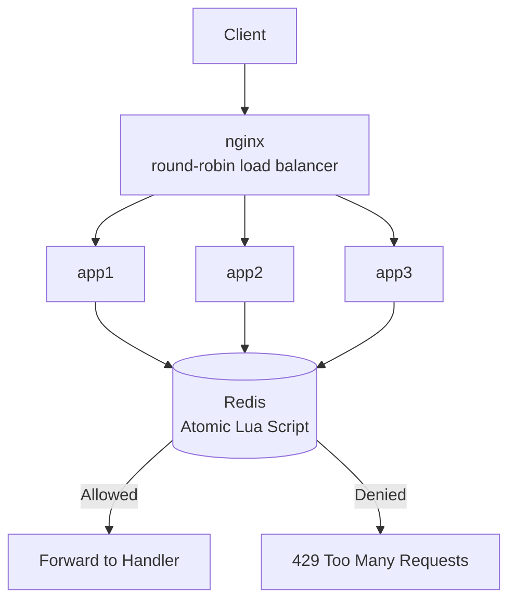

# Distributed Rate Limiter (.NET 10)

A distributed, Redis-backed rate limiting library and middleware for .NET 10, supporting multiple limiting algorithms with atomic, race-condition-free enforcement across horizontally scaled instances.

## Table of contents

- [Overview](#overview)
- [Features](#features)
- [Architecture](#architecture)
- [Design decisions](#design-decisions)
- [Algorithms](#algorithms)
- [Redis key design](#redis-key-design)
- [Request flow](#request-flow)
- [Failure handling](#failure-handling)
- [Tech stack](#tech-stack)
- [Getting started](#getting-started)
- [API reference](#api-reference)
- [Benchmarks](#benchmarks)
- [Project structure](#project-structure)
- [Future improvements](#future-improvements)

## Overview

Most rate limiter tutorials use a single in-memory counter, which silently breaks the moment you run more than one instance behind a load balancer — each instance thinks it has the full quota to give away. This project solves that with a shared Redis store and atomic Lua scripts, so the limit holds true regardless of how many app instances are running.

## Features

- Three pluggable rate limiting algorithms: Fixed Window, Sliding Window Counter, Token Bucket
- Distributed, atomic enforcement via Redis + Lua scripts (no race conditions across instances)
- .NET 10 middleware — drop into any minimal API with per-route/per-client configuration
- Standard rate limit response headers (`X-RateLimit-Remaining`, `Retry-After`)
- `/metrics` endpoint exposing allowed vs. rejected request counts
- Load tested with k6 across multiple replicas behind a load balancer

## Architecture



App instances are stateless — they hold no counters in memory. Redis is the single source of truth for rate limit state, shared across every instance, so the limit is enforced consistently no matter which instance a request lands on.

`docker compose up` runs exactly this topology locally (see [Running the cluster](#running-the-3-replica-cluster)). nginx round-robins requests, so consecutive requests from the *same* client deliberately land on *different* replicas — the case a per-process counter gets wrong.

**Real client IPs behind the proxy.** Behind nginx, every request's source IP is nginx's own address, so naive IP-based limiting would put all clients in one shared bucket. nginx sets `X-Forwarded-For`, and the app honours that header **only when the request comes from nginx's fixed address** (`ReverseProxy:TrustedProxies`). It is ignored from anyone else, so a client can't pick its own rate-limit identity by sending the header. Only the last hop is read (`ForwardLimit = 1`), and the IPv4-mapped IPv6 form of the proxy address is trusted too, because Kestrel listens on IPv6 inside containers.

## Design decisions

**Why Redis + Lua scripts, not application-level check-then-increment**

A naive "GET counter → check → INCR" from application code has a race condition: two instances can both read the same value before either writes back, letting clients burst past the limit under concurrent load. Running the check-and-increment as a single Lua script makes it atomic on Redis's single-threaded event loop — no interleaving is possible regardless of how many instances call it concurrently.

**Stateless app instances**

Keeping all rate-limit state out of the app process is what makes horizontal scaling safe. Any instance can serve any request without needing sticky sessions or in-memory sync between replicas.

## Algorithms

| Algorithm | Behavior | Weakness | Best for |
|---|---|---|---|
| Fixed Window | Simple counter reset every interval | Allows up to 2x burst at window boundaries | Simplicity over precision |
| Sliding Window Counter | Weights previous + current window by time elapsed | Approximate, not exact | Balance of accuracy and low memory overhead |
| Token Bucket | Tokens refill at a steady rate; requests consume tokens | Requires tracking last-refill timestamp | APIs that need to tolerate short, legitimate bursts |

## Redis key design

| Algorithm | Key | Value | TTL |
|---|---|---|---|
| Fixed Window | `ratelimit:fw:{clientId:route}:<windowStartMs>` | integer counter | 1x window |
| Sliding Window Counter | `ratelimit:sw:{clientId:route}:<windowStartMs>` | integer counter | 2x window (must outlive its turn as "previous") |
| Token Bucket | `ratelimit:tb:{clientId:route}` | hash `{ tokens, last_refill_ms }` | 2x window (cleanup only; a missing bucket reads as full) |

- **Window start in the key name** means "window rolled over" is just "a different key" — Redis TTLs do all the cleanup, and there is no reset logic anywhere.
- **`{clientId:route}` is a Redis Cluster hash tag.** Only the braced part is hashed, so all keys for one client+route land on the same shard. Sliding Window's script touches two keys at once, which would fail in a cluster if they lived on different shards.
- **Time comes from the app, not Redis.** Each script receives "now" from the caller's `TimeProvider` rather than calling `redis.call('TIME')`, so tests drive window rollover and refills with `FakeTimeProvider`. The trade-off is sensitivity to clock skew between instances; the Token Bucket script never lets `last_refill_ms` move backwards, so a lagging instance can't re-earn tokens.

## Request flow

1. Client request hits the load balancer, routed to any app instance
2. Middleware extracts a client identifier (API key, user ID, or IP) and the target route
3. Middleware invokes the Redis Lua script for the configured algorithm against keys tagged `{clientId:route}`
4. Redis atomically checks and updates state, returning allow/deny plus remaining quota
5. **Allowed** → request forwarded to the handler; response includes `X-RateLimit-Remaining`
6. **Denied** → middleware short-circuits with `429`, includes `Retry-After`
7. `/metrics` counters increment for allowed vs. rejected requests

## Failure handling

If Redis becomes unavailable, the limiter has two options:

- **Fail open** — allow all requests through. Preserves API availability but temporarily removes protection.
- **Fail closed** — reject all requests. Protects downstream systems but turns a Redis blip into a full outage.

**Decision: configurable per route, fail open by default.** Each policy sets `FailureMode`:

- `FailOpen` (default): the request goes through and a warning is logged. For most routes, an unprotected-but-working API beats a fully down one.
- `FailClosed`: the request gets `503 Service Unavailable`. Used in the demo for `/api/search`, an expensive endpoint that would rather switch off than run unprotected.

Client disconnects (`OperationCanceledException`) are deliberately *not* treated as limiter failures: a client giving up says nothing about Redis's health.

## Tech stack

- .NET 10 (minimal API + middleware)
- Redis (state store, Lua scripting)
- Docker Compose + nginx (local 3-replica cluster behind a load balancer)
- k6 (load testing)

## Getting started

Prerequisites: .NET 10 SDK, Docker

```bash
git clone https://github.com/sunnypatel2048/distributed-rate-limiter.git
cd distributed-rate-limiter
docker compose up -d redis                # just Redis on localhost:6379
dotnet run --project src/RateLimiter.Demo
```

Hit an endpoint until it's limited (use the port printed by `dotnet run`):

```bash
for i in $(seq 1 11); do
  curl -s -o /dev/null -w "%{http_code}\n" -H "X-Api-Key: demo" http://localhost:<port>/api/orders
done
# 200 x10, then 429
```

Run the tests:

```bash
dotnet test                                      # everything (integration tests need Docker running)
dotnet test --filter "Category!=Integration"     # fast unit tests only, no Docker
```

### Running the 3-replica cluster

```bash
docker compose up -d --build          # nginx on :8080 -> app1/app2/app3 -> Redis
./scripts/verify-cluster.sh           # one client, 30 concurrent requests
```

The script sends 30 concurrent requests to `/api/orders` (10/min) as a single client and reports how many succeeded, and which replica served each one (from the `X-Served-By` response header). It passes only if **exactly 10** were allowed in total while the requests were spread across **at least two replicas**: proof that three independent processes are enforcing one shared limit. With per-process counters, you'd see up to 30 allowed (10 per replica).

```bash
docker compose logs -f nginx          # watch round-robin: each line shows the replica picked
docker compose stop redis             # try failure handling: /api/orders fails open, /api/search returns 503
docker compose down                   # tear it all down
```

The app replicas aren't published to the host; the only way in is through nginx on port 8080.

### Using it in your own API

```csharp
builder.Services.AddSingleton<IConnectionMultiplexer>(_ => ConnectionMultiplexer.Connect("localhost:6379"));
builder.Services.AddSingleton(TimeProvider.System);
builder.Services.AddSingleton<IRateLimiterFactory, RedisRateLimiterFactory>(); // or RateLimiterFactory for in-memory
builder.Services.AddDistributedRateLimiting(builder.Configuration);

var app = builder.Build();
app.UseDistributedRateLimiting();
```

## API reference

### Configuration

Policies live in the `RateLimiting` section of `appsettings.json` and are validated at startup (duplicate names, non-positive limits or windows, and prefixes without a leading `/` fail the app on boot):

```json
"RateLimiting": {
  "ApiKeyHeader": "X-Api-Key",
  "Policies": [
    { "Name": "orders", "PathPrefix": "/api/orders", "Algorithm": "TokenBucket",
      "PermitLimit": 10, "Window": "00:01:00", "FailureMode": "FailOpen" },
    { "Name": "search", "PathPrefix": "/api/search", "Algorithm": "SlidingWindowCounter",
      "PermitLimit": 20, "Window": "00:01:00", "FailureMode": "FailClosed" },
    { "Name": "api-default", "PathPrefix": "/api", "Algorithm": "FixedWindow",
      "PermitLimit": 100, "Window": "00:01:00", "FailureMode": "FailOpen" }
  ]
}
```

- **Matching:** the longest matching `PathPrefix` wins (segment-aware and case-insensitive), so `"/"` works as a catch-all. Unmatched paths are not limited.
- **Quota scope:** one quota per client per *policy*. `/api/orders` and `/api/orders/42` draw from the same bucket.
- **Client identity:** the `X-Api-Key` header if present (SHA-256 hashed before it touches Redis), otherwise the client IP. Swap `IClientIdResolver` to key on an authenticated user instead. The API key is not validated, so in production put authentication in front of the limiter.

### Demo endpoints

| Endpoint | Policy | Algorithm | Limit |
|---|---|---|---|
| `GET /api/orders`, `GET /api/orders/{id}` | `orders` | Token Bucket | 10 / min |
| `GET /api/search?q=` | `search` | Sliding Window Counter (fail closed) | 20 / min |
| `GET /api/products` | `api-default` | Fixed Window | 100 / min |
| `GET /health`, `GET /redis-check` | none | not limited | |

### Response headers on limited routes

| Header | Description |
|---|---|
| `X-RateLimit-Limit` | Configured limit for the matched policy |
| `X-RateLimit-Remaining` | Requests remaining |
| `Retry-After` | Whole seconds until a retry can succeed (on `429` only; never `0`) |

A denied request gets `429 Too Many Requests` with a JSON body:

```json
{ "error": "rate_limited", "policy": "orders", "retryAfterSeconds": 6 }
```

## Benchmarks

_TODO — fill in after load testing (Week 2)._

| Scenario | Replicas | Throughput (req/s) | p50 latency | p95 latency | p99 latency |
|---|---|---|---|---|---|
| Sustained load | | | | | |
| Burst load | | | | | |

## Project structure

```
src/
  RateLimiter.Core/
    Algorithms/            # in-memory Fixed Window, Sliding Window Counter, Token Bucket
    Redis/                 # Redis-backed versions of the same three algorithms
      Scripts/*.lua        # atomic Lua scripts, embedded in the DLL
    RateLimiterFactory.cs        # in-memory factory
    RedisRateLimiterFactory.cs   # distributed factory
  RateLimiter.Middleware/  # ASP.NET Core middleware, route policies, client resolution
  RateLimiter.Demo/        # demo API configured entirely from appsettings.json (+ Dockerfile)
tests/
  RateLimiter.Core.Tests/        # algorithm unit tests + Redis integration tests (Testcontainers)
  RateLimiter.Middleware.Tests/  # middleware unit tests + end-to-end HTTP tests against real Redis
deploy/nginx/nginx.conf    # load balancer config
scripts/verify-cluster.sh  # proves one combined limit across replicas
docker-compose.yml         # Redis, 3 app replicas, nginx
```

## Future improvements

- Redis Cluster for high availability (remove single point of failure)
- Local in-memory caching layer with periodic sync, trading strict accuracy for lower latency
- Per-client dynamic limit configuration via an admin API
